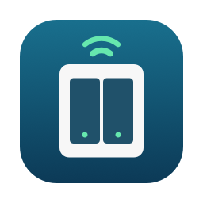
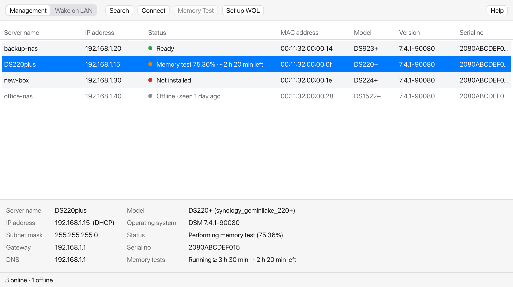
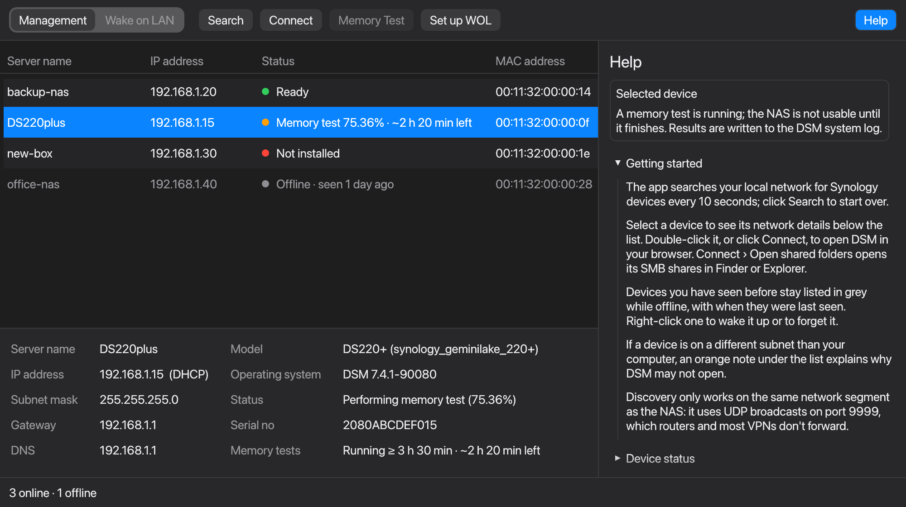

<p align="center"></p>

<h1 align="center">Synology Assistant (open-source clone)</h1>

<p align="center">
A small, fast, native replacement for Synology Assistant: find your Synology NAS on the local network,
wake it with Wake-on-LAN, and start a memory test. Runs on Apple Silicon without Rosetta, and on Windows and Linux.
</p>

<p align="center"></p>

> [!WARNING]
> **Unofficial and vibe coded.** This project is not affiliated with, endorsed by, or supported by Synology Inc.
> It was built with an AI coding assistant by reverse-engineering the network protocol of the original app.
> It works on the hardware it was tested on, but comes with **no warranty**. The memory test reboots your NAS,
> so use it knowingly. Feedback, bug reports and pull requests from anyone are very welcome. The only goal is to
> make Synology owners' lives easier.

## Why

Synology's official *Synology Assistant* for macOS is an Intel-only (x86_64) Qt app. It runs on Apple Silicon only
through Rosetta 2, which Apple is phasing out in upcoming macOS releases. This project gives you a native, dependency-light
alternative that should keep working after that.

## Features

| | |
|---|---|
| 🔍 **Discovery** | Finds Synology devices on your LAN (auto refresh every 10 s): name, IP, status, MAC, model, DSM version, serial, plus network details |
| 🌐 **Connect** | Double-click a device to open DSM (HTTP or HTTPS) in your browser |
| ⏻ **Wake on LAN** | Remember devices and wake them, locally or through a router; shows "Waking…" until the NAS answers |
| 🧪 **Memory test** | Starts Synology's built-in memory diagnostic, with progress **and an estimate of the time left** in the list, a desktop notification with the result, and a per-device history of runs |
| 🔔 **Notifications** | Memory test finished (with or without errors), and a woken NAS answering again |
| 💤 **Offline devices** | Devices seen before stay listed in grey with "last seen", and can be woken up from the list |
| 📁 **Shared folders** | Opens the NAS's SMB shares in Finder or Explorer |
| ⚠️ **Network hints** | Warns when a NAS is on a different subnet or has no DHCP address, which explains why DSM won't open |
| ❓ **Built-in help** | Help side panel (F1) explaining every device status, Wake on LAN, the memory test and troubleshooting |
| 🔐 **Encrypted login** | Admin credentials are sealed to the NAS's public key (libsodium-compatible `crypto_box_seal`), like the original app |
| ⌨️ **CLI** | `synology-assistant --scan` and `synology-assistant --wake <MAC>` |

**Not included** (yet): the original app's DSM install/network-setup wizards, drive mapping, printer management, and recovery.
To set up a new or reset NAS, open `http://<nas-ip>:5000` or <https://finds.synology.com>.

<p align="center"></p>

### Beyond the original app
The original Synology Assistant shows a memory-test percentage, but nothing about how long is left, nothing when it ends
unless you watch the window, and no record of past runs, which Synology support often asks for (usually 3 passes).
This app adds all three, keeps offline devices visible, and explains common network mistakes.

## Install

Download the build for your platform from [Releases](../../releases):

- **macOS:** unzip and move *Synology Assistant.app* to Applications. The app is ad-hoc signed, not notarized, so the
  first time you open it, right-click it and choose **Open**. Allow **Local Network** access when asked; it's needed to find your NAS.
- **Windows:** unzip and run `synology-assistant.exe`. Allow it through the firewall on *private* networks.
- **Linux:** extract and run `synology-assistant`.

Only one program at a time can listen on UDP port 9999, so quit the original Synology Assistant first.

## Build from source

Requires [Rust](https://rustup.rs) (stable).

```sh
cargo run --release           # run the app
cargo test                    # unit tests (protocol, crypto, WOL)
cargo test --release --bin synology-assistant ui_snapshots -- --ignored  # render UI screenshots to target/ui-shots
./bundle.sh                   # macOS: build dist/Synology Assistant.app
```

On Linux you need the usual windowing headers, e.g. on Debian/Ubuntu:
`sudo apt install libxkbcommon-dev libwayland-dev libx11-dev libxcursor-dev libxrandr-dev libxi-dev libgl1-mesa-dev`.

## How it works

Synology devices answer a broadcast "findhost" protocol on **UDP port 9999**. Each packet is an 8-byte header
(`12 34 56 78 'SYNO'`) followed by type-length-value fields (`[id u8][len u8][value]`, little-endian integers).
Newer DSM versions support an encrypted mode: the client includes an X25519 public key in its query, the NAS answers
sealed to that key and advertises its own, and commands are sent as `12 34 55 66 'SYNO' ‖ crypto_box_seal(packet)`.

| File | What's inside |
|---|---|
| [`src/protocol.rs`](src/protocol.rs) | Packet format, field IDs, status codes |
| [`src/secure.rs`](src/secure.rs) | Key exchange and sealed packets |
| [`src/matrix.rs`](src/matrix.rs) | The password obfuscation the original app applies before sending |
| [`src/discovery.rs`](src/discovery.rs) | Broadcast search, reply handling, memory-test command |
| [`src/wol.rs`](src/wol.rs) | Wake-on-LAN magic packets and saved devices |
| [`src/main.rs`](src/main.rs), [`src/help.rs`](src/help.rs) | The [egui](https://github.com/emilk/egui) user interface and help text |

Tested against a DS220+ on DSM 7.4.1. Reports from other models and DSM versions are very welcome. Please open an issue.

## Privacy

The app talks only to your local network (and opens your browser when you click Connect). It has no telemetry and makes
no internet connections. The Wake-on-LAN list is stored locally (e.g. `~/Library/Application Support/SynologyAssistantRS/wol.json`
on macOS), together with the memory-test history (`memtests.json`) and devices seen before (`devices.json`).
Passwords are never stored.

## Contributing

Issues and pull requests are welcome, especially:
- test results on other Synology models and DSM versions,
- the setup and install wizards of the original app,
- Windows and Linux polish (packaging, icons, installers).

## Legal

Licensed under the [MIT License](LICENSE). "Synology", "DSM" and "Synology Assistant" are trademarks of Synology Inc.,
used here only to describe compatibility. The app icon is original artwork made for this project
([`assets/icon/make_icon.swift`](assets/icon/make_icon.swift)).
